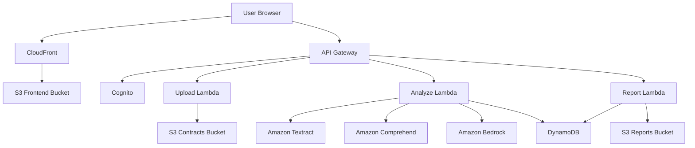

# Design Document: ContractGuard

## Overview

ContractGuard is a serverless web application that leverages AWS AI services to analyze legal contracts for Indian small businesses. The system follows a pipeline architecture where contracts flow through multiple AI-powered analysis stages, ultimately producing a comprehensive risk assessment with plain-language explanations.

The application is built entirely on AWS Free Tier services to minimize costs while demonstrating the power of AWS AI capabilities for social impact. The frontend is a React single-page application served via S3 and CloudFront, while the backend consists of Lambda functions orchestrated through API Gateway.

## Architecture

### High-Level Architecture



### Component Architecture

The system is organized into three layers:

1. **Presentation Layer**: React frontend with components for upload, dashboard, and report viewing
2. **API Layer**: API Gateway endpoints with Lambda function handlers
3. **AI Processing Layer**: AWS AI services orchestrated through Lambda functions

### Data Flow

1. User uploads PDF contract through React UI
2. Upload Lambda validates file and stores in S3
3. Analyze Lambda is triggered asynchronously
4. Text extraction via Textract
5. Entity identification via Comprehend
6. Clause analysis and risk scoring via Bedrock (Claude)
7. Compliance checking via Bedrock with Indian Contract Act knowledge
8. Results stored in DynamoDB
9. User views dashboard with real-time analysis status
10. User downloads PDF report generated on-demand

## Components and Interfaces

### Frontend Components

#### UploadComponent
- **Purpose**: Handle contract file uploads with drag-and-drop and file picker
- **State**: uploadProgress, uploadError, selectedFile
- **Methods**:
  - `handleFileSelect(file: File): void` - Validates and initiates upload
  - `handleDragDrop(event: DragEvent): void` - Handles drag-and-drop events
  - `validateFile(file: File): ValidationResult` - Checks file size and format
  - `uploadToS3(file: File): Promise<UploadResponse>` - Uploads via pre-signed URL

#### DashboardComponent
- **Purpose**: Display risk analysis results with visualizations
- **State**: analysisData, loading, error
- **Methods**:
  - `fetchAnalysis(contractId: string): Promise<AnalysisData>` - Retrieves analysis from API
  - `renderRiskChart(data: RiskData): ReactElement` - Renders risk category chart
  - `renderClauseList(clauses: Clause[]): ReactElement` - Displays clause-by-clause analysis

#### ReportComponent
- **Purpose**: Generate and download PDF reports
- **Methods**:
  - `generateReport(contractId: string): Promise<Blob>` - Requests report generation
  - `downloadReport(blob: Blob, filename: string): void` - Triggers browser download

### Backend Lambda Functions

#### UploadLambda
- **Trigger**: API Gateway POST /contracts/upload
- **Input**: `{ userId: string, fileName: string, fileSize: number, contentType: string }`
- **Output**: `{ uploadUrl: string, contractId: string }`
- **Logic**:
  1. Validate user authentication via Cognito
  2. Validate file metadata (size ≤ 10MB, type = PDF)
  3. Generate unique contractId
  4. Create pre-signed S3 upload URL (15 min expiration)
  5. Store contract metadata in DynamoDB with status "pending_upload"
  6. Return upload URL and contractId

#### AnalyzeLambda
- **Trigger**: S3 event on contract upload completion
- **Input**: S3 event with bucket and key
- **Output**: Analysis results stored in DynamoDB
- **Logic**:
  1. Extract text using Textract
  2. Identify entities using Comprehend
  3. Analyze clauses using Bedrock
  4. Calculate risk scores
  5. Check Indian Contract Act compliance
  6. Generate plain-language explanations (English and Hindi)
  7. Store complete analysis in DynamoDB
  8. Update contract status to "completed"

#### ReportLambda
- **Trigger**: API Gateway GET /contracts/{contractId}/report
- **Input**: `{ contractId: string, userId: string }`
- **Output**: PDF report as binary data
- **Logic**:
  1. Validate user owns the contract
  2. Retrieve analysis from DynamoDB
  3. Generate PDF using report template
  4. Return PDF as base64-encoded response

### AI Service Integration

#### TextractService
- **Interface**:
  ```typescript
  interface TextractService {
    extractText(s3Bucket: string, s3Key: string): Promise<ExtractedText>
  }
  
  interface ExtractedText {
    fullText: string
    blocks: TextBlock[]
    confidence: number
  }
  ```
- **Implementation**: Uses AWS SDK to call Textract DetectDocumentText API

#### ComprehendService
- **Interface**:
  ```typescript
  interface ComprehendService {
    detectEntities(text: string): Promise<Entity[]>
  }
  
  interface Entity {
    type: 'PERSON' | 'DATE' | 'QUANTITY' | 'ORGANIZATION'
    text: string
    score: number
    beginOffset: number
    endOffset: number
  }
  ```
- **Implementation**: Uses AWS SDK to call Comprehend DetectEntities API

#### BedrockService
- **Interface**:
  ```typescript
  interface BedrockService {
    analyzeContract(text: string, entities: Entity[]): Promise<ContractAnalysis>
    generateExplanation(clause: string, language: 'en' | 'hi'): Promise<string>
    checkCompliance(clause: string): Promise<ComplianceResult>
  }
  
  interface ContractAnalysis {
    clauses: AnalyzedClause[]
    risks: Risk[]
    overallScore: number
  }
  
  interface AnalyzedClause {
    text: string
    category: string
    riskLevel: number
    concerns: string[]
  }
  ```
- **Implementation**: Uses AWS SDK to invoke Claude model via Bedrock InvokeModel API
- **Prompts**:
  - Contract analysis prompt includes Indian Contract Act context
  - Explanation prompts tailored for small business audience
  - Compliance prompts reference specific sections of Indian Contract Act, 1872

## Data Models

### Contract
```typescript
interface Contract {
  contractId: string          // UUID
  userId: string              // Cognito user ID
  fileName: string
  fileSize: number
  s3Bucket: string
  s3Key: string
  uploadedAt: string          // ISO 8601 timestamp
  status: 'pending_upload' | 'uploaded' | 'analyzing' | 'completed' | 'failed'
  analysisId?: string         // Reference to Analysis
}
```

### Analysis
```typescript
interface Analysis {
  analysisId: string          // UUID
  contractId: string
  createdAt: string           // ISO 8601 timestamp
  
  // Extracted content
  extractedText: string
  entities: Entity[]
  
  // Risk assessment
  overallRiskScore: number    // 1-10
  riskCategories: {
    financial: RiskCategory
    legalLiability: RiskCategory
    intellectualProperty: RiskCategory
    termination: RiskCategory
  }
  
  // Clause analysis
  clauses: AnalyzedClause[]
  
  // Compliance
  complianceIssues: ComplianceIssue[]
  
  // Recommendations
  negotiationRecommendations: string[]
}

interface RiskCategory {
  score: number               // 1-10
  concerns: string[]
  affectedClauses: string[]   // Clause IDs
}

interface AnalyzedClause {
  clauseId: string
  text: string
  category: string
  riskScore: number           // 1-10
  concerns: string[]
  explanationEnglish: string
  explanationHindi: string
}

interface ComplianceIssue {
  clauseId: string
  issueType: 'violation' | 'jurisdiction' | 'enforceability'
  description: string
  indianContractActSection?: string
  severity: 'low' | 'medium' | 'high'
}
```

### User
```typescript
interface User {
  userId: string              // Cognito user ID
  email: string
  createdAt: string
  contractIds: string[]       // List of contract IDs owned by user
}
```

## Error Handling

### Frontend Error Handling

1. **Upload Errors**:
   - File too large: Display "File must be under 10MB"
   - Invalid format: Display "Only PDF files are supported"
   - Network error: Display "Upload failed. Please check your connection and try again"
   - Retry mechanism with exponential backoff

2. **Analysis Errors**:
   - Display loading state during analysis
   - Poll for status updates every 5 seconds
   - Timeout after 5 minutes with error message
   - Allow user to retry failed analyses

3. **Authentication Errors**:
   - Redirect to login on 401 responses
   - Display session expired message
   - Preserve user's intended action after re-authentication

### Backend Error Handling

1. **Lambda Error Handling**:
   - Wrap all operations in try-catch blocks
   - Log errors to CloudWatch with context
   - Return structured error responses with error codes
   - Implement retry logic for transient AWS service failures

2. **AWS Service Failures**:
   - Textract failure: Retry up to 3 times with exponential backoff
   - Comprehend failure: Continue analysis with reduced entity information
   - Bedrock failure: Retry with simplified prompt, fallback to basic analysis
   - S3 failure: Return 503 Service Unavailable with retry-after header

3. **Validation Errors**:
   - Return 400 Bad Request with specific validation messages
   - Validate all inputs at API Gateway level using request validators
   - Sanitize user inputs to prevent injection attacks

### Error Response Format

```typescript
interface ErrorResponse {
  error: {
    code: string              // e.g., "FILE_TOO_LARGE", "ANALYSIS_FAILED"
    message: string           // User-friendly message
    details?: any             // Additional context (not exposed to users in production)
    retryable: boolean        // Whether the operation can be retried
  }
}
```

## Testing Strategy

ContractGuard will employ a dual testing approach combining unit tests for specific scenarios and property-based tests for universal correctness guarantees.

### Unit Testing

Unit tests will focus on:
- Specific examples of valid and invalid file uploads
- Edge cases like empty PDFs, corrupted files, boundary file sizes (exactly 10MB)
- Error conditions and error message formatting
- Integration between components (mocked AWS services)
- Authentication flows and authorization checks
- Report generation with sample data

### Property-Based Testing

Property-based tests will verify universal properties across randomized inputs using **fast-check** (TypeScript/JavaScript) for frontend and Lambda functions. Each test will run a minimum of 100 iterations.

Tests will be tagged with comments referencing design properties:
```typescript
// Feature: contract-guard, Property 1: File validation consistency
```

Property tests will cover:
- File validation logic across various file sizes and types
- Risk score calculations with randomized clause data
- Entity extraction consistency
- Round-trip serialization of analysis data
- API response format consistency


## Correctness Properties

A property is a characteristic or behavior that should hold true across all valid executions of a system - essentially, a formal statement about what the system should do. Properties serve as the bridge between human-readable specifications and machine-verifiable correctness guarantees.

### Property 1: File Size Validation Consistency
*For any* file with size S, if S > 10MB then the system should reject the upload, and if S ≤ 10MB then the system should accept the upload (assuming valid PDF format).

**Validates: Requirements 1.3**

### Property 2: File Type Validation Consistency
*For any* file with MIME type T, if T = "application/pdf" then the system should accept the file (assuming valid size), and if T ≠ "application/pdf" then the system should reject the file.

**Validates: Requirements 1.4**

### Property 3: Upload Progress Monotonicity
*For any* file upload in progress, the progress percentage should be between 0 and 100, and progress values should never decrease over time.

**Validates: Requirements 1.5**

### Property 4: Upload Completion Triggers Analysis
*For any* successfully uploaded contract, the system should store the file in S3 and initiate analysis, resulting in a contract record with status transitioning from "pending_upload" to "uploaded" to "analyzing".

**Validates: Requirements 1.6**

### Property 5: Text Extraction Retry Limit
*For any* text extraction operation that fails, the system should retry exactly up to 3 times before reporting an error, never exceeding 3 retry attempts.

**Validates: Requirements 2.3**

### Property 6: Entity Position Validity
*For any* identified entity, the beginOffset and endOffset values should be valid indices within the extracted text, with beginOffset < endOffset.

**Validates: Requirements 3.4**

### Property 7: Risk Score Bounds
*For any* identified risk (financial, legal liability, IP, or termination), the assigned risk score should be between 1 and 10 inclusive.

**Validates: Requirements 5.1, 5.2, 5.3, 5.4**

### Property 8: Overall Risk Score Calculation
*For any* contract analysis with risk category scores, the overall risk score should equal the weighted average of the four category scores (financial, legal liability, IP, termination), and should also be between 1 and 10.

**Validates: Requirements 5.5**

### Property 9: Explanation Generation Completeness
*For any* analyzed clause containing legal terminology, the system should generate both an English explanation and a Hindi explanation, with neither being empty.

**Validates: Requirements 6.1, 6.2**

### Property 10: Concerning Provisions Highlighted
*For any* clause with a risk score ≥ 7, the generated explanation should include highlighting markers or indicators to draw attention to concerning provisions.

**Validates: Requirements 6.3**

### Property 11: Jurisdiction Detection
*For any* clause text containing jurisdiction specifications (country names, state names, legal system references), if the jurisdiction is outside India, the system should flag a jurisdiction issue.

**Validates: Requirements 7.3**

### Property 12: Compliance Findings Inclusion
*For any* completed analysis, the Analysis_Report should contain a complianceIssues field (which may be empty if no issues found), ensuring compliance data is always included in the output structure.

**Validates: Requirements 7.4**

### Property 13: High-Risk Recommendation Generation
*For any* clause with a risk score ≥ 7, the system should generate at least one negotiation recommendation for that clause.

**Validates: Requirements 8.4**

### Property 14: Risk Color Coding Consistency
*For any* risk score S, the system should assign colors consistently: green if S ≤ 3, yellow if 4 ≤ S ≤ 6, red if S ≥ 7.

**Validates: Requirements 8.5**

### Property 15: Report Content Completeness
*For any* generated PDF report, the report should contain all required sections: overall risk score, risk category breakdowns, clause-by-clause analysis with explanations, compliance findings, and negotiation recommendations.

**Validates: Requirements 9.2, 9.3, 9.4, 9.5, 9.6**

### Property 16: Report Download URL Validity
*For any* successful report generation, the system should return a download URL that is non-empty and properly formatted (valid URL structure).

**Validates: Requirements 9.7**

### Property 17: Authentication Rejection Consistency
*For any* login attempt with invalid credentials (wrong password, non-existent user, malformed input), the system should reject the attempt and return an error message without revealing which part of the credentials was invalid.

**Validates: Requirements 10.3**

### Property 18: Contract Ownership Association
*For any* uploaded contract, the contract record should contain the userId of the authenticated user who uploaded it, ensuring proper ownership tracking.

**Validates: Requirements 10.4**

### Property 19: Data Isolation
*For any* authenticated user with userId U, when retrieving contracts or analyses, the system should only return records where the associated userId equals U.

**Validates: Requirements 10.5**

### Property 20: S3 Retrieval Round-Trip
*For any* contract file successfully stored in S3, retrieving the file using the stored S3 key should return the same file content (byte-for-byte equality).

**Validates: Requirements 11.3**

### Property 21: File Organization by User
*For any* stored contract file, the S3 key should include the userId as a path component, ensuring files are organized by user account.

**Validates: Requirements 11.4**

### Property 22: Pre-signed URL Expiration
*For any* generated pre-signed URL, the URL should include an expiration parameter, and the expiration time should be in the future (not already expired).

**Validates: Requirements 11.5**

### Property 23: API Request Routing
*For any* API request to a valid endpoint, the request should be routed to exactly one Lambda function handler, never to multiple handlers or to no handler.

**Validates: Requirements 13.3**

### Property 24: Free Tier Warning Threshold
*For any* AWS service usage metric, when usage exceeds 80% of the free tier limit, the system should log a warning message.

**Validates: Requirements 14.2**

### Property 25: User-Friendly Error Messages
*For any* error displayed to users, the error message should not contain technical implementation details such as stack traces, AWS service error codes, or internal variable names.

**Validates: Requirements 15.1, 15.4**

### Property 26: Error Logging Completeness
*For any* error that occurs, the system should log the error with at least the following information: timestamp, error type, error message, and context (user ID, contract ID, or operation being performed).

**Validates: Requirements 15.2**

### Property 27: Retry Availability After Failure
*For any* failed analysis operation, the system should provide a retry mechanism, allowing the user to re-attempt the analysis without re-uploading the contract.

**Validates: Requirements 15.3**

### Property 28: Error Explanation Completeness
*For any* contract processing failure, the error message should include both an explanation of what went wrong and at least one suggested corrective action.

**Validates: Requirements 15.5**


## AWS Free Tier Considerations

### Service Usage Limits

1. **Amazon Textract**:
   - Free Tier: 1,000 pages/month for first 3 months
   - Strategy: Limit to single-page contract summaries or first 10 pages
   - Monitoring: Track page count per analysis

2. **Amazon Comprehend**:
   - Free Tier: 50,000 units/month for first 12 months (1 unit = 100 characters)
   - Strategy: Batch entity detection calls, limit text to key sections
   - Monitoring: Track character count per request

3. **Amazon Bedrock**:
   - Free Tier: Varies by model; Claude has limited free tier
   - Strategy: Use efficient prompts, cache common analyses
   - Monitoring: Track token usage per request

4. **Amazon S3**:
   - Free Tier: 5GB storage, 20,000 GET requests, 2,000 PUT requests/month
   - Strategy: Implement file size limits, cleanup old analyses after 30 days
   - Monitoring: Track storage usage and request counts

5. **AWS Lambda**:
   - Free Tier: 1M requests/month, 400,000 GB-seconds compute
   - Strategy: Optimize function memory allocation, use async processing
   - Monitoring: Track invocation counts and duration

6. **Amazon Cognito**:
   - Free Tier: 50,000 MAUs (Monthly Active Users)
   - Strategy: Sufficient for competition demo and initial users
   - Monitoring: Track active user count

7. **API Gateway**:
   - Free Tier: 1M API calls/month for first 12 months
   - Strategy: Implement caching for repeated requests
   - Monitoring: Track API call volume

### Cost Optimization Strategies

1. **Lazy Loading**: Only invoke AI services when user explicitly requests analysis
2. **Result Caching**: Store analysis results to avoid re-processing same contracts
3. **Batch Processing**: Group multiple operations where possible
4. **Async Processing**: Use S3 event triggers instead of synchronous Lambda chains
5. **Cleanup Jobs**: Scheduled Lambda to delete old contracts and analyses

## Security Considerations

### Authentication and Authorization

1. **Cognito User Pools**: Manage user authentication with email verification
2. **JWT Tokens**: Use Cognito-issued JWTs for API authorization
3. **API Gateway Authorizers**: Validate tokens before Lambda invocation
4. **IAM Roles**: Least-privilege roles for Lambda functions

### Data Protection

1. **Encryption at Rest**: S3 server-side encryption (SSE-S3)
2. **Encryption in Transit**: HTTPS/TLS for all API communication
3. **Pre-signed URLs**: Time-limited access to S3 objects (15 min expiration)
4. **Input Validation**: Sanitize all user inputs to prevent injection attacks

### Privacy

1. **Data Isolation**: User contracts stored in user-specific S3 prefixes
2. **Access Control**: DynamoDB queries filtered by userId
3. **No Data Sharing**: Contracts and analyses never shared between users
4. **Data Retention**: Optional auto-deletion after 30 days

## Deployment Architecture

### Infrastructure as Code

Use AWS CDK (Cloud Development Kit) with TypeScript to define infrastructure. The infrastructure will be provisioned as part of the implementation process.

#### Required AWS Resources

1. **S3 Buckets**:
   - `contract-guard-frontend-{env}`: Static website hosting for React app
   - `contract-guard-contracts-{env}`: Encrypted storage for uploaded contracts
   - `contract-guard-reports-{env}`: Generated PDF reports

2. **CloudFront Distribution**:
   - Origin: Frontend S3 bucket
   - HTTPS only, custom domain (optional)
   - Caching configuration for static assets

3. **Cognito User Pool**:
   - Email-based authentication
   - Password policy: min 8 chars, uppercase, lowercase, number
   - Email verification required

4. **DynamoDB Tables**:
   - `ContractGuard-Contracts-{env}`: Contract metadata
     - Partition key: contractId (String)
     - GSI: userId-uploadedAt-index for user queries
   - `ContractGuard-Analyses-{env}`: Analysis results
     - Partition key: analysisId (String)
     - GSI: contractId-index for contract lookups

5. **Lambda Functions**:
   - `contract-guard-upload-{env}`: Handle upload requests
   - `contract-guard-analyze-{env}`: Process contracts with AI services
   - `contract-guard-report-{env}`: Generate PDF reports
   - `contract-guard-auth-{env}`: Custom Cognito triggers

6. **API Gateway**:
   - REST API with Cognito authorizer
   - Endpoints: /contracts, /contracts/{id}, /contracts/{id}/report
   - CORS enabled for frontend domain

7. **IAM Roles**:
   - Lambda execution roles with least-privilege permissions
   - S3 access policies for each bucket
   - Bedrock, Textract, Comprehend access policies

8. **CloudWatch**:
   - Log groups for each Lambda function
   - Custom metrics for usage tracking
   - Alarms for Free Tier limit warnings

#### CDK Stack Structure

```typescript
// Simplified CDK stack structure
class ContractGuardStack extends Stack {
  constructor(scope: Construct, id: string, props: StackProps) {
    super(scope, id, props)
    
    const env = props.env || 'dev'
    
    // S3 Buckets
    const frontendBucket = new s3.Bucket(this, 'Frontend', {
      bucketName: `contract-guard-frontend-${env}`,
      websiteIndexDocument: 'index.html',
      publicReadAccess: true,
      blockPublicAccess: s3.BlockPublicAccess.BLOCK_ACLS,
      removalPolicy: RemovalPolicy.DESTROY
    })
    
    const contractsBucket = new s3.Bucket(this, 'Contracts', {
      bucketName: `contract-guard-contracts-${env}`,
      encryption: s3.BucketEncryption.S3_MANAGED,
      blockPublicAccess: s3.BlockPublicAccess.BLOCK_ALL,
      lifecycleRules: [{
        expiration: Duration.days(30) // Auto-cleanup
      }]
    })
    
    const reportsBucket = new s3.Bucket(this, 'Reports', {
      bucketName: `contract-guard-reports-${env}`,
      encryption: s3.BucketEncryption.S3_MANAGED,
      blockPublicAccess: s3.BlockPublicAccess.BLOCK_ALL,
      lifecycleRules: [{
        expiration: Duration.days(7)
      }]
    })
    
    // CloudFront Distribution
    const distribution = new cloudfront.Distribution(this, 'CDN', {
      defaultBehavior: { 
        origin: new origins.S3Origin(frontendBucket),
        viewerProtocolPolicy: cloudfront.ViewerProtocolPolicy.REDIRECT_TO_HTTPS
      },
      defaultRootObject: 'index.html',
      errorResponses: [{
        httpStatus: 404,
        responseHttpStatus: 200,
        responsePagePath: '/index.html' // SPA routing
      }]
    })
    
    // Cognito User Pool
    const userPool = new cognito.UserPool(this, 'Users', {
      userPoolName: `contract-guard-users-${env}`,
      selfSignUpEnabled: true,
      signInAliases: { email: true },
      autoVerify: { email: true },
      passwordPolicy: {
        minLength: 8,
        requireLowercase: true,
        requireUppercase: true,
        requireDigits: true,
        requireSymbols: false
      }
    })
    
    const userPoolClient = userPool.addClient('WebClient', {
      authFlows: {
        userPassword: true,
        userSrp: true
      }
    })
    
    // DynamoDB Tables
    const contractsTable = new dynamodb.Table(this, 'Contracts', {
      tableName: `ContractGuard-Contracts-${env}`,
      partitionKey: { name: 'contractId', type: dynamodb.AttributeType.STRING },
      billingMode: dynamodb.BillingMode.PAY_PER_REQUEST,
      encryption: dynamodb.TableEncryption.AWS_MANAGED,
      removalPolicy: RemovalPolicy.DESTROY
    })
    
    contractsTable.addGlobalSecondaryIndex({
      indexName: 'userId-uploadedAt-index',
      partitionKey: { name: 'userId', type: dynamodb.AttributeType.STRING },
      sortKey: { name: 'uploadedAt', type: dynamodb.AttributeType.STRING }
    })
    
    const analysesTable = new dynamodb.Table(this, 'Analyses', {
      tableName: `ContractGuard-Analyses-${env}`,
      partitionKey: { name: 'analysisId', type: dynamodb.AttributeType.STRING },
      billingMode: dynamodb.BillingMode.PAY_PER_REQUEST,
      encryption: dynamodb.TableEncryption.AWS_MANAGED,
      removalPolicy: RemovalPolicy.DESTROY
    })
    
    analysesTable.addGlobalSecondaryIndex({
      indexName: 'contractId-index',
      partitionKey: { name: 'contractId', type: dynamodb.AttributeType.STRING }
    })
    
    // Lambda Functions
    const uploadLambda = new lambda.Function(this, 'Upload', {
      functionName: `contract-guard-upload-${env}`,
      runtime: lambda.Runtime.NODEJS_18_X,
      handler: 'upload.handler',
      code: lambda.Code.fromAsset('lambda/upload'),
      environment: {
        CONTRACTS_BUCKET: contractsBucket.bucketName,
        CONTRACTS_TABLE: contractsTable.tableName,
        USER_POOL_ID: userPool.userPoolId
      },
      timeout: Duration.seconds(30)
    })
    
    const analyzeLambda = new lambda.Function(this, 'Analyze', {
      functionName: `contract-guard-analyze-${env}`,
      runtime: lambda.Runtime.NODEJS_18_X,
      handler: 'analyze.handler',
      code: lambda.Code.fromAsset('lambda/analyze'),
      environment: {
        CONTRACTS_BUCKET: contractsBucket.bucketName,
        CONTRACTS_TABLE: contractsTable.tableName,
        ANALYSES_TABLE: analysesTable.tableName
      },
      timeout: Duration.minutes(5),
      memorySize: 1024
    })
    
    const reportLambda = new lambda.Function(this, 'Report', {
      functionName: `contract-guard-report-${env}`,
      runtime: lambda.Runtime.NODEJS_18_X,
      handler: 'report.handler',
      code: lambda.Code.fromAsset('lambda/report'),
      environment: {
        ANALYSES_TABLE: analysesTable.tableName,
        REPORTS_BUCKET: reportsBucket.bucketName
      },
      timeout: Duration.seconds(30)
    })
    
    // Grant permissions
    contractsBucket.grantReadWrite(uploadLambda)
    contractsBucket.grantRead(analyzeLambda)
    contractsTable.grantReadWriteData(uploadLambda)
    contractsTable.grantReadWriteData(analyzeLambda)
    analysesTable.grantReadWriteData(analyzeLambda)
    analysesTable.grantReadData(reportLambda)
    reportsBucket.grantReadWrite(reportLambda)
    
    // Grant AI service permissions
    analyzeLambda.addToRolePolicy(new iam.PolicyStatement({
      actions: [
        'textract:DetectDocumentText',
        'comprehend:DetectEntities',
        'bedrock:InvokeModel'
      ],
      resources: ['*']
    }))
    
    // S3 trigger for analyze Lambda
    analyzeLambda.addEventSource(new S3EventSource(contractsBucket, {
      events: [s3.EventType.OBJECT_CREATED],
      filters: [{ suffix: '.pdf' }]
    }))
    
    // API Gateway
    const api = new apigateway.RestApi(this, 'API', {
      restApiName: `contract-guard-api-${env}`,
      defaultCorsPreflightOptions: {
        allowOrigins: [distribution.distributionDomainName],
        allowMethods: apigateway.Cors.ALL_METHODS,
        allowHeaders: ['Content-Type', 'Authorization']
      }
    })
    
    const authorizer = new apigateway.CognitoUserPoolsAuthorizer(this, 'Authorizer', {
      cognitoUserPools: [userPool]
    })
    
    // API endpoints
    const contracts = api.root.addResource('contracts')
    contracts.addMethod('POST', new apigateway.LambdaIntegration(uploadLambda), {
      authorizer,
      authorizationType: apigateway.AuthorizationType.COGNITO
    })
    
    const contract = contracts.addResource('{contractId}')
    contract.addMethod('GET', new apigateway.LambdaIntegration(uploadLambda), {
      authorizer,
      authorizationType: apigateway.AuthorizationType.COGNITO
    })
    
    const report = contract.addResource('report')
    report.addMethod('GET', new apigateway.LambdaIntegration(reportLambda), {
      authorizer,
      authorizationType: apigateway.AuthorizationType.COGNITO
    })
    
    // Outputs
    new CfnOutput(this, 'FrontendURL', {
      value: `https://${distribution.distributionDomainName}`
    })
    new CfnOutput(this, 'ApiURL', {
      value: api.url
    })
    new CfnOutput(this, 'UserPoolId', {
      value: userPool.userPoolId
    })
    new CfnOutput(this, 'UserPoolClientId', {
      value: userPoolClient.userPoolClientId
    })
  }
}
```

#### Infrastructure Provisioning Steps

1. **Install AWS CDK**: `npm install -g aws-cdk`
2. **Configure AWS credentials**: `aws configure`
3. **Bootstrap CDK**: `cdk bootstrap aws://ACCOUNT-ID/REGION`
4. **Deploy stack**: `cdk deploy ContractGuardStack`
5. **Note outputs**: Save API URL, User Pool ID, Client ID for frontend config

### Deployment Pipeline

1. **Development**: Local testing with AWS SAM or LocalStack
2. **Staging**: Deploy to AWS with "-staging" suffix on resources
3. **Production**: Deploy to AWS with production configuration
4. **CI/CD**: GitHub Actions workflow for automated deployment

### Monitoring and Logging

1. **CloudWatch Logs**: All Lambda function logs
2. **CloudWatch Metrics**: Custom metrics for usage tracking
3. **CloudWatch Alarms**: Alerts for free tier limit approaching
4. **X-Ray**: Distributed tracing for debugging (optional)

## Development Workflow

### Frontend Development

1. **Framework**: React 18 with TypeScript
2. **Build Tool**: Vite for fast development and optimized builds
3. **State Management**: React Context API for global state
4. **UI Library**: Tailwind CSS for styling
5. **Charts**: Recharts for risk visualization
6. **PDF Generation**: jsPDF for client-side report generation (fallback)

### Backend Development

1. **Runtime**: Node.js 18.x for Lambda functions
2. **Language**: TypeScript for type safety
3. **AWS SDK**: AWS SDK v3 for service integration
4. **Testing**: Jest for unit tests, fast-check for property tests
5. **Linting**: ESLint with TypeScript rules

### Local Development Setup

1. Install dependencies: `npm install`
2. Configure AWS credentials: `aws configure`
3. Deploy infrastructure: `cdk deploy`
4. Run frontend locally: `npm run dev`
5. Test Lambda functions: `sam local invoke`

## Competition-Specific Requirements

### Timeline (29 days remaining until March 13, 2026)

**Week 1 (Days 1-7)**: Infrastructure and Core Upload
- Set up AWS account and services
- Implement frontend upload component
- Implement upload Lambda and S3 storage
- Basic authentication with Cognito

**Week 2 (Days 8-14)**: AI Integration
- Integrate Textract for text extraction
- Integrate Comprehend for entity detection
- Integrate Bedrock for clause analysis
- Implement risk scoring logic

**Week 3 (Days 15-21)**: Analysis and Dashboard
- Implement Indian Contract Act compliance checking
- Build risk dashboard UI
- Implement plain-language explanations (English/Hindi)
- Generate negotiation recommendations

**Week 4 (Days 22-28)**: Polish and Documentation
- Implement PDF report generation
- Add error handling and retry logic
- Write competition article
- Create demo video
- Final testing and bug fixes

**Day 29**: Submit article by March 13, 2026, 4:00 AM IST

### Article Requirements

The competition article must include:
1. Problem statement and target audience
2. Solution architecture with AWS services
3. Social impact for Indian small businesses
4. Technical implementation details
5. Demo screenshots or video
6. Cost analysis (Free Tier usage)
7. Future enhancements
8. Link to GitHub repository (if public)

### Demo Preparation

1. **Sample Contracts**: Prepare 3-5 sample contracts with varying risk levels
2. **Test Accounts**: Create demo user accounts
3. **Screenshots**: Capture key UI screens for article
4. **Video**: Record 2-3 minute demo walkthrough
5. **Metrics**: Document analysis accuracy and performance

## Future Enhancements

Beyond the competition scope, potential enhancements include:

1. **Multi-language Support**: Add support for more Indian languages (Tamil, Telugu, Bengali)
2. **Contract Templates**: Provide pre-vetted contract templates for common scenarios
3. **Comparison Mode**: Compare multiple contract versions side-by-side
4. **Collaboration**: Allow users to share analyses with advisors
5. **Mobile App**: Native iOS/Android apps for on-the-go analysis
6. **Advanced Analytics**: Track common risk patterns across user base (anonymized)
7. **Legal Expert Network**: Connect users with lawyers for complex cases
8. **Contract Generation**: AI-assisted contract drafting with risk minimization
9. **Notification System**: Email alerts for high-risk clauses
10. **API Access**: Allow integration with other business tools

